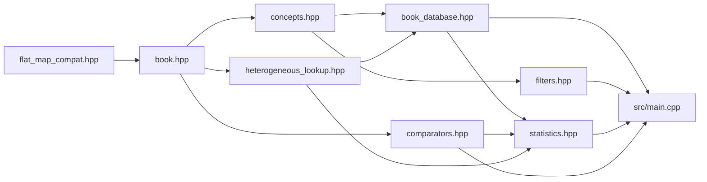

# cpp-middle-project3 - documentation hub

`cpp-middle-project3` is a header-only C++23 library that keeps a list of books in memory and answers
questions about it: sorting by one field, filtering by year, rating and genre, an author histogram, average
ratings, a random sample and a top-N. A console demo, `BookDB`, exercises the library. The README says the
project began as the sprint 3 project of the Yandex Practicum "Middle C++ developer" course (`README.md`).
Who else is meant to use the library is not stated (see [SPEC.md, open questions](../SPEC.md#9-open-questions)).

The requirements reverse-engineered from the code are in [`SPEC.md`](../SPEC.md).

## Status

| Item | State | Source |
| --- | --- | --- |
| Last commit touching `include/`, `src/`, `tests/*.cpp` or `CMakeLists.txt` | `45c8e62`, 2026-11-07, "refactor(core): settle the sources under clang-tidy and clang-format" | `git log` |
| Documented commit | `86d4eea`, 2026-11-07, tagged `v1.0.0` | `git log`, `git tag` |
| History | 24 commits, first one 2025-06-21 | `git log` |
| Version | `1.0.0` | `recipe.ps1:13`, `CMakeLists.txt:2` (`conanfile.py:8` still says `0.0.1`) |
| Tests | 25 GoogleTest cases in 7 files, plus 2 pytest cases over the manual-test list | `tests/*.cpp`, `tests/test_manual_list.py` |
| CI | Five Gitea workflows on a `windows` runner; no GitHub Actions. Whether they have run is not recorded in the repository | `.gitea/workflows/`, `CLAUDE.md` ("Branch protection starts at stage 1") |
| TODO / FIXME markers in own code | 0 | search over `include`, `src`, `tests` |

Evidently unfinished or open:

- The demo passes title and author in swapped order, so its output columns are swapped and its last lookup
  finds nothing (`src/main.cpp:42-51`, `docs/manual.md`).
- The README lists nine exceptions to lab requirements revision 4.0.0 (R-02, R-09, R-12, R-13 twice, R-14,
  R-37, R-41, R-42), tracked as issues #8-#16 on a Gitea server at a loopback address (`README.md`).
- `tests/manual/tests.json` holds an empty list: no manual test is defined.

## Layout

| Path | What it is |
| --- | --- |
| `include/book.hpp` | `Genre`, `GenreFromString`, `StringFromGenre`, `Book`, formatters for `Genre` and `Book` |
| `include/concepts.hpp` | `BookContainerLike`, `BookIterator`, `BookSentinel`, `BookPredicate`, `BookComparator` |
| `include/book_database.hpp` | `BookDatabase<Container>` and its formatter for `std::vector<Book>` |
| `include/comparators.hpp` | `bookdb::comp::LessBy*` and `GreaterBy*` functors |
| `include/filters.hpp` | `YearBetween`, `RatingAbove`, `GenreIs`, `all_of`, `any_of`, `filterBooks` |
| `include/statistics.hpp` | Histogram, genre ratings, average, sample, top-N, and a formatter for `bookdb::flat_map` |
| `include/heterogeneous_lookup.hpp` | `TransparentStringLess`, `TransparentStringEqual`, `TransparentStringHash` |
| `include/flat_map_compat.hpp` | `bookdb::flat_map`: alias of `std::flat_map`, or a sorted-vector replacement |
| `src/main.cpp` | Console demo `BookDB` |
| `tests/*.cpp` | GoogleTest suites; `tests/main.cpp` is the test runner `main` |
| `CMakeLists.txt` | Targets `bookdb` (INTERFACE), `BookDB`, `BookDB_tests`; ctest entries `bookdb_tests`, `manual_list` |
| `.clang-tidy`, `.clang-format` | Lint and format rules applied by `recipe.ps1 test` |
| `CMakePresets.json`, `conanfile.py`, `scripts/build_windows.ps1`, `.devcontainer/`, `.vscode/`, `run_clang_format.sh` | Earlier build routes (Conan, dev container, MSVC). `docs/install.md` says no gate runs them |

## Architecture

The library is a set of headers in namespace `bookdb`. `BookDatabase` owns a container of `Book` values and an
`std::unordered_set<std::string>` of author names; each stored `Book::author` is a `std::string_view` into that
set (`include/book_database.hpp:28-61`). Filters and statistics are free functions over iterators or over a
`BookDatabase`; filters, sample and top-N return `std::reference_wrapper<const Book>` into the database
(`include/filters.hpp:33-45`, `include/statistics.hpp:75-114`). There is no I/O, persistence, network or
threading. The diagram is the include graph of the headers and the demo.



## Build and run

Prerequisites, from `docs/install.md` and `CMakeLists.txt:1,6`: mingw g++ 13 or newer, CMake 3.28 or newer,
Ninja, LLVM (`clang-tidy`, `clang-format`), C++23. The ctest entry `manual_list` runs `python -m pytest`, so a
Python with pytest on `PATH` is also needed (`CMakeLists.txt:60-64`). The first configure downloads GoogleTest
1.13.0 as an archive pinned by SHA-256 (`CMakeLists.txt:33-43`).

| Command | What it does | Source |
| --- | --- | --- |
| `.\recipe.ps1 build` | `cmake -S . -B build -G Ninja -DCMAKE_CXX_COMPILER=g++ -DCMAKE_BUILD_TYPE=Release`, then `cmake --build build` | `recipe.ps1:56-62,89-92` |
| `.\recipe.ps1 run` | Builds, then runs `build\BookDB.exe` | `recipe.ps1:101-106` |
| `.\recipe.ps1 test` | Builds, runs ctest, clang-tidy, clang-format and two word searches (see Testing) | `recipe.ps1:126-143` |
| `.\recipe.ps1 clean` | Deletes `dist`, `build`, `out` | `recipe.ps1:95-100` |

Using the library elsewhere: put `include` on the include path and compile with C++23 (`docs/install.md`).
`recipe.ps1` prepends `C:\Program Files\LLVM\bin` and `C:\ProgramData\mingw64\mingw64\bin` to its own `PATH`
when they exist (`recipe.ps1:51-54`).

## Configuration

| Name | Kind | Meaning | Default | Source |
| --- | --- | --- | --- | --- |
| `BUILD_TESTING` | CMake option | Build `BookDB_tests` and register the ctest entries | `ON` | `CMakeLists.txt:12,30` |
| `CMAKE_CXX_STANDARD` | CMake variable | Language standard; set with a plain `set`, so a `-D` or preset value is shadowed (reproduced with CMake) | `23`, fixed | `CMakeLists.txt:6` |
| `LAB_SHARE` | env var | Target root for `recipe.ps1 publish`; the verb fails when it is unset | unset | `recipe.ps1:107-117` |
| `.claude/.env` | file, gitignored | `NAME=value` lines loaded into the environment by `recipe.ps1`; a variable already set wins | absent | `recipe.ps1:40-49`, `.gitignore` |
| `$RunArgs` | recipe arguments | Passed to `build\BookDB.exe` by `run`; the demo's `main()` takes no arguments | none | `recipe.ps1:5-6,104`, `src/main.cpp:28` |

The library itself has no configuration. The test binary accepts GoogleTest flags (`docs/manual.md`).

## Usage

Library, adapted from `docs/manual.md` (the last line is added here; the manual states that `std::format`
prints a `BookDatabase<std::vector<Book>>`):

```cpp
BookDatabase<> db;
db.EmplaceBack("George Orwell", "1984", 1949, Genre::SciFi, 4.8, 200);
auto good = filterBooks(db.begin(), db.end(), all_of(YearBetween(1900, 1999), RatingAbove(4.5)));
auto top = getTopNBy(db, 1, comp::GreaterByRating{});   // reorders db
auto histogram = buildAuthorHistogramFlat(db);
double average = calculateAverageRating(db);
std::string text = std::format("{}", db);                 // vector-backed database only
```

Demo: `.\recipe.ps1 run` prints the ten books, the books sorted by author and by popularity, the histogram, the
average rating per genre and overall, the books from 1900-1999 with rating 4.5 or more, and "Top 3 books by
rating" (`src/main.cpp:39-85`). The top three use `comp::LessByRating`, so they are the three lowest-rated books
(`src/main.cpp:78`; observed in a run, see "About this document").

## Testing

`.\recipe.ps1 test` (`recipe.ps1:126-143`) sets `core.hooksPath`, builds, runs `ctest --test-dir build
--output-on-failure --no-tests=error`, runs `clang-tidy -p build` on `src/main.cpp` and `tests/*.cpp`, runs
`clang-format -i` on the tracked sources (reformats, never fails on style; the Gitea workflows run
`git diff --exit-code` after it), fails on any lock or synchronisation word in `include` and `src`, and
fails on `throw`, `try` or `catch` there except exactly 4 lines in `include/book.hpp` and
`include/statistics.hpp` (`recipe.ps1:32-35`). Its verdict is the exit code (`CLAUDE.md`, rule 3).

| Suite | Cases | Covers |
| --- | --- | --- |
| `tests/book_test.cpp` | 5 | Genre conversions incl. unknown-name throw, `Book` constructors, `Genre` and `Book` formatting |
| `tests/concepts_test.cpp` | 1 | `static_assert`s on the five concepts |
| `tests/book_database_test.cpp` | 5 | Initializer list, author de-duplication, `Clear`, `[]`/`at`, sorting the container |
| `tests/comparators_test.cpp` | 1 | Six `LessBy*` functors through `std::sort` |
| `tests/filters_test.cpp` | 6 | Three filters, `all_of`, `any_of`, empty result |
| `tests/heterogeneous_lookup_test.cpp` | 1 | `find("Orwell")` in an `unordered_set` with the transparent hash and equality |
| `tests/statsistics_test.cpp` | 6 | Histogram, genre ratings, average, sample (incl. throw), top-N by rating and by popularity |

Not covered by a test: `PushBack`, the `Book(std::string_view)` genre-name constructor, the `BookDatabase` and
`flat_map` formatters, `TransparentStringLess` on its own, the `getTopNBy` throw and `n == 0`, the
`sampleRandomBooks` empty-database branch, the `StringFromGenre` throw, the demo output. Single runs and filters:
`build\BookDB_tests.exe --gtest_filter=FiltersTest.*`, `--gtest_list_tests` (`docs/manual.md`).

## Known limitations and problems

- `YearBetween`, `RatingAbove` and `GenreIs` are non-inline functions defined in `include/filters.hpp:11-21`.
  Two translation units that include the header fail to link with duplicate symbols (reproduced with clang++,
  see below). In this repository each executable has one unit that includes it (`src/main.cpp`,
  `tests/filters_test.cpp`).
- Copying a `BookDatabase` copies the `string_view`s as they are: the copy's books point at the source's author
  set, not at the copy's (reproduced, see below). Destroying the source leaves them dangling.
- `RatingAbove(x)` keeps ratings equal to `x` (`>=`, `include/filters.hpp:16`).
- `sampleRandomBooks` returns an empty list for an empty database whatever the count, so it does not throw for
  "a count above the size" there, unlike what `README.md` says (`include/statistics.hpp:80-86`).
- `getTopNBy` uses `books.begin() + n` and `partial_sort` (`include/statistics.hpp:106`), and the
  initializer-list constructor calls `reserve` (`include/book_database.hpp:33`). `BookContainerLike` requires
  neither, so `BookDatabase<std::list<Book>>` compiles but its initializer-list constructor does not
  (reproduced). `std::format` support exists only for `BookDatabase<std::vector<Book>>`.
- `Book() = default` leaves `year`, `genre`, `rating`, `read_count` uninitialised (`include/book.hpp:72-77`).
- Authors in the database formatter come out in `unordered_set` order (`include/book_database.hpp:97-100`).
- Results of `filterBooks`, `sampleRandomBooks`, `getTopNBy` and the histogram keys refer into the database and
  live only as long as it does (`docs/manual.md`).
- Demo: swapped title/author and the lowest-rated "Top 3" (see Usage). Its "Transparent lookup" line uses
  `std::find_if`, not the transparent functors (`src/main.cpp:82-85`).

## Repository tooling

The repository follows [repo-quality-template](https://github.com/IGORSVOLOHOVS/repo-quality-template), lab
requirements revision 4.0.0 (`README.md`, "Lab requirements"). Specific to this project:

- `recipe.ps1`: `$Name = 'cpp-middle-project3'`, `$Code = 'cmp3'`, `$Version = '1.0.0'`, `$Needs` and `$Tools`
  empty, no `$App` (library, no installer), `$Provides = @('include', 'src')` (`recipe.ps1:11-20`).
- Verbs that act: `build`, `run`, `test`, `clean`, `info`, `publish` (copies `include` and `src` to
  `$env:LAB_SHARE\needs\cpp-middle-project3\v1.0.0`). `install` and `uninstall` only print that there is nothing
  to do (`recipe.ps1:93-94`).
- Project-specific: `$ThrowsOnPurpose` and `$ThrowLinesOnPurpose = 4`, the exact count of exception lines allowed
  in `include/book.hpp` and `include/statistics.hpp` (`recipe.ps1:32-35,76-84`).
- Deviations: `.claude/.env` is gitignored and keys are never committed (`CLAUDE.md` rule 4, `.gitignore`); one
  reviewer login, approvals 0; pre-lab history kept as it was (`CLAUDE.md`, "Where this repository is
  deliberately relaxed"). The template's `.pre-commit-config.yaml`, `CHANGELOG.md`, `SECURITY.md`,
  `CODE_OF_CONDUCT.md` and `docs/branching.md`, `docs/workflow.md` are not in this repository.

## Related documents

- [`../README.md`](../README.md) - project overview
- [`../SPEC.md`](../SPEC.md) - requirements specification
- [`install.md`](install.md) - toolchain and the two header fallbacks
- [`manual.md`](manual.md) - library, demo and test-binary usage
- [`../CLAUDE.md`](../CLAUDE.md) - rules for work in this repository
- [`../CONTRIBUTING.md`](../CONTRIBUTING.md) - issue, branch, commit and pull-request flow
- [`../LICENSE`](../LICENSE) - MIT, copyright Yandex Practicum

## About this document

Written 2026-11-18 from commit `86d4eea` (branch `release`), by reading the files named above.

Run to check it: `git log`, `git ls-files`, `git tag`; `clang++ -std=c++23 -fsyntax-only -Iinclude
src/main.cpp` (clang 20.1.0, MSVC target, exit 0); the demo built with that clang++ in a temporary directory
and run (output matches the Usage section); a two-unit link that includes `filters.hpp` (duplicate symbols for
the three filter functions); compile checks of `BookDatabase<std::list<Book>>` and of a copied database's author
views, both in a temporary directory; a CMake configure in a temporary directory with `-DCMAKE_CXX_STANDARD=26`
over a plain `set(CMAKE_CXX_STANDARD 23)` (23 wins); `python -m pytest tests/test_manual_list.py -q -p
no:cacheprovider` (2 passed).

Not run: `.\recipe.ps1` in any verb, `ctest`, `BookDB_tests.exe`, `clang-tidy`, `clang-format`. mingw g++ is not
at the path the recipe expects on the machine used, and the first configure downloads GoogleTest. The demo was
therefore built with clang++ and the MSVC standard library, not with g++. `CMakePresets.json`,
`scripts/build_windows.ps1`, the dev container and the Gitea workflows were not run.
